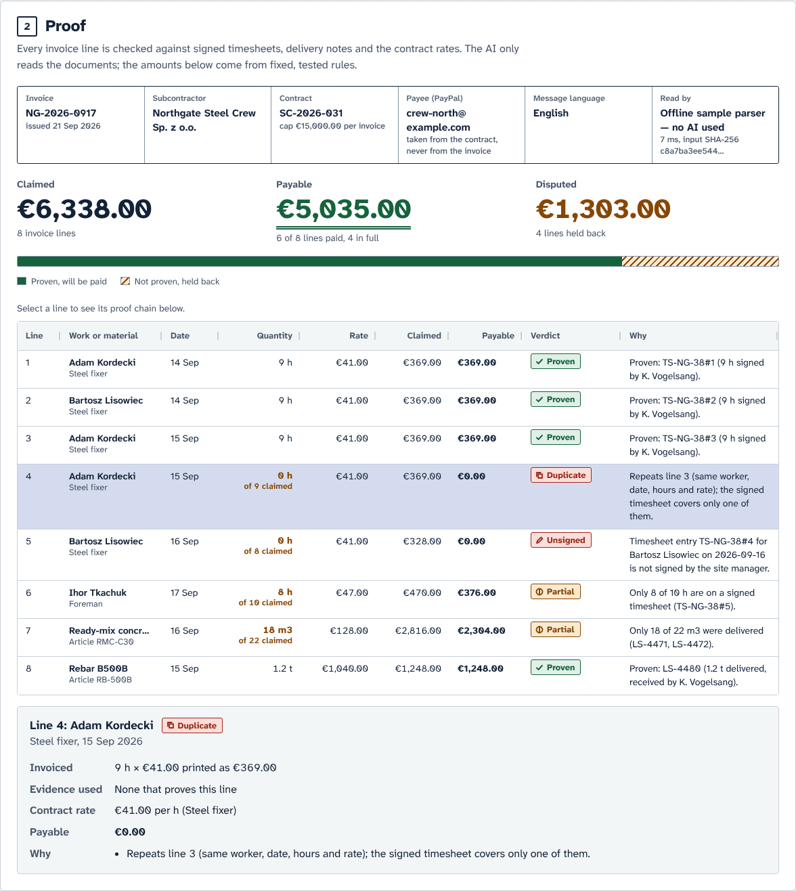
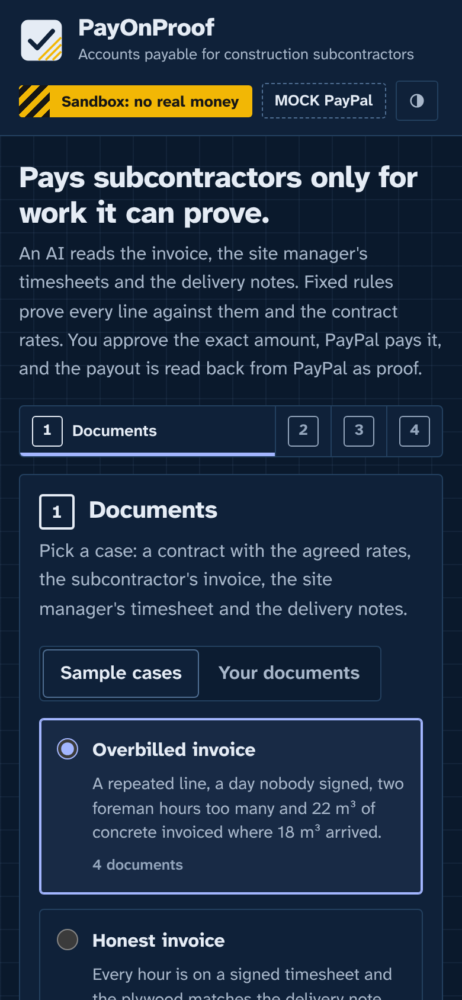
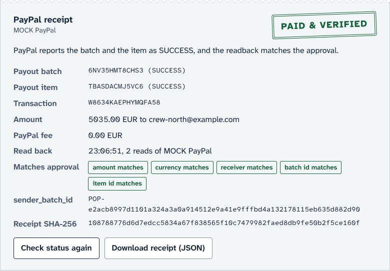

# PayOnProof

**An AI accounts-payable agent that pays subcontractors only for work it can prove, through PayPal.**

AI reads the messy documents. A deterministic engine proves every invoice line against signed timesheets, delivery notes and contract rates. A person approves the exact payment. PayPal Payouts pays only the proven amount, and the payout is read back from PayPal as proof.



Built for the PayPal AI Hackathon (Best Use of PayPal + AI, agentic commerce) and the Nebius × NVIDIA Global AI Hackathon (Best Apps and Agents). Uses the PayPal developer platform (Payouts, sandbox), NVIDIA Nemotron through Nebius Token Factory (or Gemini, or any OpenAI-compatible model), AG Grid Community and runs on Render.

---

## Why

A general contractor on a German building site receives invoices from subcontractor crews (often from Poland or Ukraine) that claim hours and materials. The site manager has the signed timesheets, the delivery notes and the contract rates, but cross-checking them is manual. Payments are either slow or overpaid: repeated lines, hours nobody signed, rates above the contract, more concrete than was delivered, simple arithmetic errors.

AI agents could pay these invoices automatically. An agent that pays without proof is dangerous. PayOnProof lets the AI do the reading and keeps the money decisions in rules that can be checked, a person's explicit approval and PayPal's own records.

## 60-second demo

```bash
npm install
npm run demo          # offline sample parser + MOCK PayPal, no keys needed
# open http://127.0.0.1:4410
```

1. Keep **Overbilled invoice** selected and click **Verify against evidence**.
2. The grid shows each line: a duplicate, a day without the site manager's signature, two foreman hours too many, 22 m³ of concrete invoiced where 18 m³ arrived. **€6,338.00 claimed, €5,035.00 payable.**
3. Click line 7 to see its proof chain (delivery notes LS-4471 and LS-4472, 9 m³ each).
4. Read the message to the subcontractor. Try **Polish invoice, German site papers** for a message in Polish, or **Rate drift** for Ukrainian.
5. Tick the confirmation and click **Approve exactly this payment**. The preview hash and a single-use, 10-minute approval appear.
6. Click **Pay with PayPal (sandbox)**. The receipt shows the PayPal batch id, item and transaction ids, statuses and **PAID & VERIFIED**, read back from PayPal.
7. Click Pay again: refused. Edit the message: the approval is withdrawn because the preview hash changed.

With real sandbox credentials (see [PayPal sandbox setup](#paypal-sandbox-setup)) the same flow pays a sandbox account through `api-m.sandbox.paypal.com`.

| Phone, dark | Receipt |
| --- | --- |
|  |  |

## How it works

```
 contract / rate sheet ─┐
 invoice ───────────────┼─► AI extraction, one call per document ─► strict validator ─► integer cents
 timesheets ────────────┤   (Gemini | OpenAI-compatible | offline        (schema.mjs)      and thousandths
 delivery notes ────────┘    sample parser, never trusted for math)
                                                   │
                                                   ▼
                         verification engine (verify.mjs, pure functions, no AI)
                         verdict + reason + evidence ids + payable cents per line
                                                   │
                     ┌─────────────────────────────┴─────────────────────────────┐
                     ▼                                                           ▼
     message to the subcontractor (en/de/pl/uk)                proposal: payee, currency, cents,
     AI phrasing is fact-checked, else template                paid lines, message hash, documents hash
                     └─────────────────────────────┬─────────────────────────────┘
                                                   ▼
                              previewHash = SHA-256(canonical JSON of the proposal)
                                                   ▼
                person approves in the UI ─► single-use token bound to previewHash, 10 min
                                                   ▼
     PayPal Payouts  POST /v1/payments/payouts   sender_batch_id = "POP-" + previewHash
                                                   ▼
     read back       GET  /v1/payments/payouts/{payout_batch_id}   (polled with backoff)
                                                   ▼
     receipt JSON + SHA-256; "PAID & VERIFIED" only if PayPal says SUCCESS and the readback
     matches the approved amount, currency, receiver, sender_batch_id and sender_item_id
```

## Verification rules

All money is integer cents; quantities are integer thousandths. Each line gets one verdict (the first that applies, in this order) and lists every finding.

| Verdict | Rule | Paid |
| --- | --- | --- |
| `DUPLICATE` | Same worker or item, date, quantity and price as an earlier line, and the remaining evidence cannot cover it again | 0 |
| `UNPROVEN` | No timesheet entry or delivery note for that worker or item on that date; no contract rate for the role or item, or for the trade written on the signed timesheet; unit differs from the contract; evidence already used by earlier lines | 0 |
| `UNSIGNED` | Timesheet entries exist but none is signed by the site manager named on the sheet (a sign-off by anyone else, for example the worker, counts as not signed) | 0 |
| `ROLE_MISMATCH` | The signed timesheet gives another trade than the invoice (a steel fixer billed as foreman) | at the contract rate of the trade on the timesheet, never above the invoiced price |
| `PARTIAL` | Signed hours or delivered quantity below the claim | proven quantity × allowed rate |
| `RATE_ABOVE_CONTRACT` | Unit price above the contract rate | at the contract rate |
| `MATH_ERROR` | Printed line total differs from quantity × price by one cent or more | the correct product, but never more than printed |
| `OVER_INVOICE_TOTAL` | The printed invoice total is below what the proven lines come to | up to the printed total (the lines that cross it are cut, in invoice order) |
| `OVER_CAP` | The contract's payment cap per invoice is reached | up to the cap |
| `PROVEN` | Fully evidenced at or below the contract rate, arithmetic correct | as invoiced |

- **Who signed**: a sign-off counts only when its name fits the site manager printed on the timesheet: the surname written in full (diacritics folded, any order) and any initials consistent. `K. Vogelsang` and `Vogelsang, Katrin` fit `Katrin Vogelsang`; `T. Brzezina` and `T. Vogelsang` do not, and the line says "signed by T. Brzezina, not by the site manager Katrin Vogelsang". If a sheet names no site manager, or a sign-off has no name, the signer cannot be checked: the entry still counts and a warning says so. The AI only copies the names; this rule decides.
- **Evidence is consumed line by line**: one signed day or one delivery note can never prove two lines. Two identical lines are both paid when the evidence really covers both (two concrete trucks on the same day).
- **Matching is deterministic**: names are compared order-independently with diacritics folded (`Kordecki, Adam` = `Adam Kordecki`, `Paweł` = `Pawel`), materials by article code or name, roles by name or the aliases written in the contract (`Dachdecker` / `Dekarz`; the trade on the signed timesheet must be the same role as on the invoice), units through a fixed table (`Std.`, `godz.`, `h`; `m³`, `m3`; `Rolle`, `rol.`).
- **Never more than invoiced**: a line pays at most its printed amount and the case pays at most the printed invoice total, so claimed = payable + disputed, line by line and in total. When the proven work comes to more than a line's printed amount, the line is paid as printed and an informational `UNDERBILLED` note (in the line and in the message) says how much more could be invoiced; it is never paid automatically.
- **Rounding**: a line amount is quantity × unit price rounded half-up to the cent, per line. Totals are sums of rounded lines and are never rounded again. A printed line total within one cent of the exact product is correct (any rounding convention) and is paid exactly as printed; otherwise the correct product is paid, or the printed amount if that is lower.
- **Case checks**: a currency that differs from the contract blocks payment. A different PayPal address on the invoice is flagged and ignored: the payee always comes from the contract. A printed invoice total that does not add up is flagged, and the payout never exceeds it.

## PayPal integration

| Step | Call | Details |
| --- | --- | --- |
| Token | `POST /v1/oauth2/token` | Client credentials, Basic auth with `PAYPAL_CLIENT_ID:PAYPAL_CLIENT_SECRET`, cached until 60 s before expiry, refreshed once on any 401 |
| Pay | `POST /v1/payments/payouts` | One `EMAIL` item, `amount.value` from integer cents (`"5035.00"`), `note` with a short reference, `sender_item_id` = case id, `sender_batch_id` = `POP-<previewHash>`, `PayPal-Request-Id` = the same value |
| Read back | `GET /v1/payments/payouts/{payout_batch_id}` | Polled until the batch or item reaches a final state (`SUCCESS`, `DENIED`, `CANCELED`, `UNCLAIMED`, `FAILED`, `RETURNED`, …) |

**No double payment, by construction:**

1. The approval token is single-use and bound to one exact `previewHash`.
2. A case sends at most one payout; a second pay request is refused.
3. `sender_batch_id` is derived from the approved `previewHash`. PayPal processes a `sender_batch_id` at most once in 30 days and answers a repeat with an error that links to the existing batch. PayOnProof then reads that batch instead of paying again.

**Errors are reported honestly:**

- Connection refused or credentials rejected: `NOT_SENT`, nothing was paid, approve again to retry.
- Timeout, lost connection or a 5xx after the request left: `UNKNOWN_AFTER_SEND`. Nothing is retried automatically. **Reconcile with PayPal** presents the identical approved request with the same `sender_batch_id`; PayPal either creates the single approved batch (if the first request never arrived) or points to the existing one, which is then read back. This is PayPal's documented safe retry for payouts.
- Validation or business errors (for example insufficient funds): `REJECTED` with PayPal's error name, message and debug id.
- Readback: `PAID & VERIFIED` only when the batch and the item are `SUCCESS` and PayPal's amount, currency, receiver, `sender_batch_id` and `sender_item_id` match what was approved. `UNCLAIMED` (the receiver has no PayPal account yet) and `PENDING` are shown as such, a mismatch as `MISMATCH`.

The receipt is canonical JSON with its own SHA-256, downloadable from the page.

**Sandbox only.** The PayPal base URL must be `https://api-m.sandbox.paypal.com`; the server refuses to start with any other value. Live PayPal would need both `PAYPAL_BASE_URL=https://api-m.paypal.com` and `PAYPAL_ALLOW_LIVE=I_UNDERSTAND`, and stays disabled in this project. Secrets and tokens are never logged; each PayPal call logs only method, path, status, PayPal debug id and duration.

**MOCK PayPal** (`PAYPAL_MOCK=1` or `npm run demo`) swaps only the network layer for an in-process fake of the sandbox API (`src/paypal-mock.mjs`): OAuth, request validation, duplicate `sender_batch_id`, `PENDING → PROCESSING → SUCCESS`, `UNCLAIMED`. The same client code runs against it, and the UI labels it **MOCK PayPal**.

## What the AI does, and what it never decides

| AI does | AI never decides |
| --- | --- |
| Turns each document (English, German, Polish, Ukrainian) into strict JSON | Any amount, total or verdict |
| Phrases the explanation to the subcontractor in their language | Who gets paid (the payee comes from the contract) |
| | Whether to pay (only a person's approval can) |

- **Providers** (`AI_PROVIDER`): `nebius` calls NVIDIA Nemotron on Nebius Token Factory (see [below](#nvidia-nemotron-on-nebius-token-factory)). `gemini` calls `POST https://generativelanguage.googleapis.com/v1beta/models/${GEMINI_MODEL}:generateContent` (default `gemini-2.5-flash`) with the key in the `x-goog-api-key` header and `generationConfig: { responseMimeType: 'application/json', temperature: 0 }`. `openai` calls any OpenAI-compatible `/chat/completions` endpoint (`AI_BASE_URL`, `AI_API_KEY`, `AI_MODEL`, for example local Ollama at `http://127.0.0.1:11434/v1`) with `response_format: {type: 'json_object'}`, dropped automatically if the server rejects it. `offline` (the default without keys) is a deterministic parser for the bundled sample layout only, labelled **Offline sample parser — no AI used** everywhere.
- **Fallback for the bundled samples only**: if the AI provider fails while reading a sample (network, HTTP error, budget, unusable JSON or an answer that fails validation), that case is read by the offline sample parser instead and labelled **AI unavailable (reason) — offline sample parser used for this sample**, with a warning in the findings. Pasted documents never fall back: they stay unreadable and nothing is verified.
- **Isolation**: each document is extracted in its own call and wrapped as untrusted data, so text in the subcontractor's invoice cannot influence how the site manager's timesheets are read. The claimant can never create evidence.
- **Validation**: a hand-written validator (`src/schema.mjs`) rejects missing fields, non-numbers, localised number strings (`"1.040,00"`), negative values, impossible dates, duplicate ids and over-precise values; plain numeric strings are converted with a visible warning. A document that cannot be read stops the whole check: the page says **Cannot verify** and why, and shows no verdicts, no payable figure and no message, because they would be built from missing evidence. Nothing can be approved until readable documents are verified again.
- **No model arithmetic**: printed totals are kept only as the claim; every payable amount is recomputed in integer cents.
- **Provenance**: every extraction records provider, model, prompt version, duration and the SHA-256 of the input documents, shown on screen.
- **Messages**: AI drafts must contain the totals and every disputed line with its exact paid amount; otherwise the fixed template is used and the page says so. A person can edit the text before approving, which changes the preview hash and is labelled "Edited by a person". Text an agent sends over MCP must pass the same fact check as an AI draft, or it is refused and nothing changes; when it passes it is labelled "Written by an AI agent over MCP".
- **Cost guard**: `AI_MAX_CALLS_PER_HOUR` caps model calls for the whole server; identical documents are served from a cache.

## NVIDIA Nemotron on Nebius Token Factory

The AI steps run on an NVIDIA open model through [Nebius Token Factory](https://tokenfactory.nebius.com)'s OpenAI-compatible API.

| Step | Call | Model |
| --- | --- | --- |
| Read each document into strict JSON (one isolated call per document, four per sample case) | `POST https://api.tokenfactory.nebius.com/v1/chat/completions`, `response_format: {type: 'json_object'}`, `temperature: 0` | `NEBIUS_MODEL`, default `nvidia/NVIDIA-Nemotron-3-Nano-30B-A3B` |
| Draft the explanation to the subcontractor in their language (fact-checked before use) | same endpoint | same model |

- **Setup**: create a key at tokenfactory.nebius.com > **API keys** and set `NEBIUS_API_KEY` (in `.env` or the Render dashboard). With only `NEBIUS_API_KEY` set, the provider is chosen automatically; `NEBIUS_MODEL` picks another catalog model. The key is sent only as `Authorization: Bearer …` to `NEBIUS_BASE_URL` and is redacted from every error.
- **What Nemotron decides**: nothing about money. It turns text into fields; the validator rejects anything malformed; amounts and verdicts come from the deterministic engine; a person approves; PayPal pays.
- **Reasoning output**: if the model writes its reasoning before the answer (`…</think>`), only the answer after it is parsed; an answer cut off while still reasoning is reported as incomplete and blocks payment.
- **Cost guard**: `AI_MAX_CALLS_PER_HOUR` and `AI_MAX_CALLS_PER_DAY` cap model calls for the whole server, and identical documents are served from a cache, so the public demo stays inside its credits.

## Agentic commerce over MCP

`POST /mcp` speaks MCP over Streamable HTTP (stateless, JSON responses), protocol version **2025-11-25** (`@modelcontextprotocol/sdk` 1.32.1, which also accepts 2025-06-18 and older clients).

| Tool | What it does |
| --- | --- |
| `payonproof_verify_case` | Documents (or a `sampleId`) in, verdicts and a `caseId` out |
| `payonproof_propose_payment` | Returns the exact preview, its `previewHash`, status `AWAITING_HUMAN_APPROVAL` and an `approvalUrl` for the person. An optional `messageText` replaces the message only if it passes the AI fact check (else `MESSAGE_FACT_CHECK_FAILED` with what is missing); it withdraws any approval, so the tool is not idempotent |
| `payonproof_pay_approved` | Pays only with a valid approval token from the person; without one it returns `HUMAN_APPROVAL_REQUIRED` |
| `payonproof_payout_status` | Reads the payout back from PayPal and returns the receipt |

There is no approval tool, and no tool accepts the approver passcode. An agent verifies and proposes, hands the person the `approvalUrl`, the person approves in the page (with the approver passcode) and gives the agent the single-use token (**Copy token for an MCP agent**), and the agent pays. What keeps an agent from approving by itself is the passcode, not MCP: an agent that also has a plain HTTP tool could call `/api/approve` directly, so on a server without a passcode (allowed only on 127.0.0.1, see [Safety model](#safety-model)) it could approve. Try it with the MCP Inspector (`npx @modelcontextprotocol/inspector`, transport Streamable HTTP, URL `http://127.0.0.1:4410/mcp`, connected through the Inspector's proxy). Set `MCP_BEARER_TOKEN` to require `Authorization: Bearer …` on `/mcp`.

## HTTP API

| Method and path | Purpose |
| --- | --- |
| `GET /health` | Liveness, AI and PayPal mode, MCP protocol version |
| `GET /api/config` | What the UI may know: AI label, PayPal mode, approval settings (no secrets) |
| `GET /api/cases` | The bundled sample cases with their documents |
| `POST /api/analyze` | `{sampleId}` or `{documents: [{type, name, text}]}`: extract, verify, draft the message, build the proposal |
| `GET /api/cases/:id` | A case as shown in the UI |
| `POST /api/message` | `{caseId, text}`: replace the message (new previewHash, approvals withdrawn) |
| `POST /api/approve` | `{caseId, previewHash, confirm: true, passcode}`: the human approval. Needs the approver passcode whenever `APPROVER_PASSCODE` is set (always on a reachable server); 20 wrong passcodes in 15 minutes lock it for everyone for 15 minutes (`429 APPROVALS_LOCKED`, with the time approvals reopen) |
| `POST /api/pay` | `{caseId, approvalToken}`: pay through PayPal and read back |
| `GET /api/payout/:id` | Read the payout back from PayPal again (never sends anything) |
| `POST /api/payout/:id/reconcile` | Resolve `UNKNOWN_AFTER_SEND` with the same `sender_batch_id` |
| `POST /mcp` | MCP Streamable HTTP endpoint |

State-changing requests must be JSON and, when they carry an `Origin`, come from the same origin; `/api/approve` requires it. That stops other websites from acting through a visitor's browser. It is not authentication: any program can send an `Origin` header.

## Safety model

- Money logic is pure, deterministic and tested; the AI cannot change an amount or a verdict.
- Evidence and claims come from different parties and are read separately.
- The payee is taken from the contract, never from the invoice; a different address on the invoice raises a warning.
- Approval is explicit, exact (hash-bound), single-use, short-lived and withdrawn by any change.
- **The approver passcode is the approval boundary.** Whenever the server can be reached beyond this computer (`PORT`, `RENDER`, a non-loopback `ALLOWED_HOSTS` or `PUBLIC_BASE_URL`), it refuses to start without an `APPROVER_PASSCODE` of at least 8 characters. Passcodes are compared in constant time. After 20 wrong passcodes within 15 minutes, approvals are refused for everyone for 15 minutes (`429 APPROVALS_LOCKED`, and the page says when they reopen); the lockout is global, so changing IP addresses does not help, and the per-IP limits apply as well. MCP has no approval tool and never accepts the passcode. The `Origin` check only stops other websites.
- **Without a passcode** (allowed only while the server listens on 127.0.0.1, as `npm run demo` does), anything that can send HTTP to 127.0.0.1 can approve: a script, or an agent with an HTTP tool. Set `APPROVER_PASSCODE` locally too if other programs on the computer are not trusted.
- Three independent layers prevent double payment (see above); unknown outcomes are reconciled, never blindly retried.
- Sandbox only; startup refuses unsafe PayPal settings.
- HTTP hardening: strict Content-Security-Policy (scripts only from the same origin, no inline scripts; `<style>` elements need a per-request nonce, which the grid uses), Host allow-list against DNS rebinding, same-origin checks on state-changing requests, JSON-only bodies, 768 KB body limit, per-IP rate limits (behind a proxy the client address is the right-most `X-Forwarded-For` entry, the one the proxy appended; entries a client adds to the left are ignored), no `innerHTML` with data in the client.
- Secrets are read from the environment or `.env` and are never printed, logged or sent anywhere except their own API.

## PayPal sandbox setup

1. Sign in at [developer.paypal.com](https://developer.paypal.com) with any PayPal account.
2. Open **Apps & Credentials**, switch to **Sandbox** and open the **Default Application** (or create an app of type Merchant). Copy the **Client ID** and **Secret**.
3. In that app's features, make sure **Payouts** is enabled.
4. Open **Testing Tools > Sandbox Accounts** and copy the email of the **Personal** sandbox account (it looks like `sb-xxxxxxxx@personal.example.com`). The sample payees are fictional `example.com` addresses that PayPal cannot pay, so every payout goes to this account instead.
5. Create `.env` (copy `.env.example`):
   ```dotenv
   PAYPAL_CLIENT_ID=your-sandbox-client-id
   PAYPAL_CLIENT_SECRET=your-sandbox-secret
   PAYEE_EMAIL_OVERRIDE=sb-xxxxxxxx@personal.example.com
   ```
   Leave `PAYPAL_MOCK` empty.
6. `npm start`, open `http://127.0.0.1:4410`, run a sample, approve and pay. The approval panel states that the sandbox override replaces the contract payee. Check the payment in the sandbox Personal account at [sandbox.paypal.com](https://www.sandbox.paypal.com).
7. The samples are in EUR. If the payout is rejected because of currency or funds, create a sandbox **Business** account with country Germany (EUR), create a sandbox app linked to it and use that app's credentials.

## Run locally

Requires Node.js 22 or newer.

```bash
npm install
npm start            # 127.0.0.1:4410; offline AI; PayPal as configured in .env
npm run demo         # same, but with MOCK PayPal (no network at all)
```

Use NVIDIA Nemotron on Nebius Token Factory by adding `NEBIUS_API_KEY` (and optionally `NEBIUS_MODEL`) to `.env`, Gemini with `GEMINI_API_KEY` (and optionally `GEMINI_MODEL`), or a local model with `AI_PROVIDER=openai`, `AI_BASE_URL=http://127.0.0.1:11434/v1`, `AI_MODEL=<model>`. Leave `AI_PROVIDER` empty to let the key choose the provider; a value there wins over every key. With an AI provider you can paste any plain-text documents on the **Your documents** tab; offline mode reads only the sample layout (start from a sample and change numbers to watch the verdicts move). Every variable is documented in [`.env.example`](.env.example).

## Deploy on Render

1. Push the repository to GitHub.
2. In Render: **New > Web Service**, connect the repository. Runtime **Node**, build command `npm ci`, start command `npm start`, instance type **Free**, health check path `/health`. (Or **New > Blueprint** with the included `render.yaml`.)
3. Environment variables: `APPROVER_PASSCODE` (**required**, at least 8 characters; the server refuses to start on Render without it), `PAYPAL_CLIENT_ID`, `PAYPAL_CLIENT_SECRET`, `PAYEE_EMAIL_OVERRIDE` (or `PAYPAL_MOCK=1` for a mock-only demo), an AI key (`NEBIUS_API_KEY` or `GEMINI_API_KEY`), `AI_MAX_CALLS_PER_HOUR`, `AI_MAX_CALLS_PER_DAY`, `MCP_BEARER_TOKEN`.
4. Render sets `PORT` and `RENDER_EXTERNAL_HOSTNAME`; the server then listens on `0.0.0.0`, allows that host name and trusts the proxy headers (it takes the right-most `X-Forwarded-For` address, which Render's proxy appends). Add custom domains to `ALLOWED_HOSTS`.

Free instances sleep when idle; cases, approvals and receipts live in memory and are gone after a restart.

## Tests

```bash
npm test             # node --test: 120 tests, no network
npm run e2e          # real Chromium: picks a sample, approves, pays via MOCK PayPal, writes docs/img/*.png
```

The unit and integration tests cover every verdict and the rounding rules, the extraction validator (missing fields, numbers as strings, localised strings, negatives), the offline parser on all samples against fixtures in `test/fixtures/`, proposal hash stability and invalidation, approval single use, expiry and hash binding, the PayPal client against mocked responses (token, exact payout body and `sender_batch_id`, duplicate batch, 401 refresh, timeout to `UNKNOWN_AFTER_SEND` and reconciliation, rejections, readback), the MCP tools through a real MCP client (`HUMAN_APPROVAL_REQUIRED` without approval), the HTTP server (CSP, Host and Origin checks, limits) and the UI files. External APIs are only ever reached through an injectable `fetch`; tests use `127.0.0.1` only. The e2e script needs the Chromium build that matches the pinned `playwright-core` (`npx playwright-core install chromium` once, or `PLAYWRIGHT_BROWSERS_PATH` pointing at an existing install) and fails on console errors, CSP violations or horizontal scrolling at 390 px.

## Project layout

```
server.mjs              HTTP server, API, static files, security headers
mcp.mjs                 MCP tools over Streamable HTTP
src/ai.mjs              Nebius Token Factory, Gemini, OpenAI-compatible and offline providers
src/extract.mjs         per-document extraction, provenance, cache
src/offline-parser.mjs  deterministic reader for the sample layout (not AI)
src/schema.mjs          strict validator, normalises to cents and thousandths
src/verify.mjs          verification engine (pure)
src/message.mjs         message to the subcontractor, templates in en/de/pl/uk
src/proposal.mjs        payment proposal and previewHash
src/approval.mjs        single-use, hash-bound approval tokens
src/paypal.mjs          PayPal OAuth2, Payouts, readback, error classes
src/paypal-mock.mjs     MOCK PayPal (in-process sandbox fake)
src/receipt.mjs         receipt, readback checks, SHA-256
src/service.mjs         the flow shared by the API and MCP
public/                 UI (index.html, app.js, styles.css, vendor/, fonts/)
samples/                four fictional cases
test/                   node --test suites and expected-verdict fixtures
docs/img/               screenshots (desktop 1280×800 and phone 390×844, light and dark)
```

## Scope and limitations

- Documents are plain text (paste or `.txt` upload). PDFs and photos would need an OCR or PDF-to-text step first.
- Offline mode reads only the bundled sample layout; real documents need an AI provider. The AI adapters are tested against recorded response shapes; a live Gemini or sandbox run happens outside this repository's tests.
- Cases, approvals and receipts are kept in memory on a single instance. A production system needs a database, user accounts and strong approver authentication (SSO or passkeys) instead of one shared passcode: here anyone who knows the passcode can approve, and without a passcode (127.0.0.1 only) any local program can. The global lockout means a stranger can block approvals for 15 minutes by sending wrong passcodes, but cannot approve.
- Duplicate detection works within one invoice; the same invoice submitted again as a new case is not detected across cases.
- Matching after normalisation is exact by design (no fuzzy matching). Roles and items in other languages need an alias or article code in the contract.
- Amounts are net. VAT and reverse charge are out of scope. Only currencies with two decimals are accepted.
- The MOCK PayPal reports a fee of 0.00; the sandbox reports its own values.
- All companies, people, addresses and email addresses in the samples are fictional.

## License

MIT, see [LICENSE](LICENSE). Third-party components and their licenses: [THIRD_PARTY_NOTICES.md](THIRD_PARTY_NOTICES.md). PayPal is a trademark of PayPal, Inc.; this project is not affiliated with PayPal.
